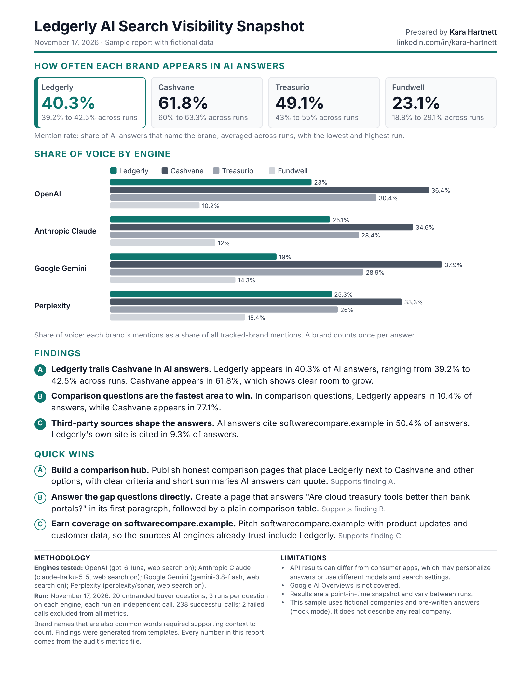

# aeo-audit

[](https://github.com/karabuilds/aeo-audit/actions/workflows/ci.yml)


**A command-line tool that measures how often a company appears in AI-generated answers, compares it with competitors, and turns the results into a one-page report a marketing leader can act on.**

## The problem

Buyers now ask ChatGPT, Claude, Gemini and Perplexity questions like "what's a good banking app with no monthly fees?" before they ever visit a website. Brands cannot see how those answers describe them, or whether they show up at all. Answer engine optimization (AEO) starts with measuring that visibility, and most teams have no repeatable way to do it.

## Sample report

This sample uses a fictional company (Ledgerly) and fictional competitors, generated in mock mode from pre-written answers. It does not describe any real company.

[](samples/ledgerly/report.pdf)

[PDF](samples/ledgerly/report.pdf) · [HTML](samples/ledgerly/report.html) · [metrics.json](samples/ledgerly/metrics.json) · [raw answers](samples/ledgerly/raw)

## What aeo-audit measures

aeo-audit asks each AI engine a set of real buyer questions, with live web search turned on, and records every answer. For the company and each competitor, it reports:

| Metric | What it tells you |
|---|---|
| **Mention rate** | How often the brand appears in answers |
| **Share of voice** | The brand's share of all tracked-brand mentions |
| **Average position** | Whether the brand is named first, second or later |
| **Owned citation rate** | How often answers cite the brand's own website |
| **Top cited third-party sites** | The review sites, publishers and forums AI engines rely on. These are where content gaps live. |
| **Gap list** | Questions where a competitor appears in most answers and the company appears in none |
| **By intent and topic** | Visibility for discovery, problem, comparison, use case and evaluation questions, and for weighted topics |
| **Consistency** | How stable the company's appearance is from one run to the next |

### Why it reports ranges

AI answers change between runs, even for the same question. A single number would overstate certainty. aeo-audit asks every question several times on every engine and reports each headline metric as an average with its lowest and highest run, for example "40.3% (39.2% to 42.5% across runs)".

## How it works

```
company file ──> buyer questions ──> human review ──> run on 4 engines ──> analysis ──> metrics.json ──> report
                 (no brand names)    (required)       (web search on)     (mentions,                    (one page,
                                                                           citations)                    HTML and PDF)
```

1. **Company file.** A short YAML file names the company, its aliases, category, target buyer and 2 to 3 competitors, with optional topic weights.
2. **Buyer questions.** Claude writes short, plain questions in everyday wording, spread across five intents. An automated check rejects any question that contains a tracked name, alias or domain, including split or glued spellings, and regenerates it.
3. **Human review.** The tool stops and waits. Questions only run after a person approves them, and editing a question later requires approval again.
4. **Runs.** Each question runs several times on each engine as an independent call with no shared history.
5. **Analysis.** The tool finds brand mentions and cited sources in every answer.
6. **Metrics.** Every number goes into `metrics.json`, the single source of truth.
7. **Report.** Claude writes 3 findings and 3 quick wins from `metrics.json` alone. Every number in the text is checked against `metrics.json`, and a draft that fails is regenerated. After 3 failed attempts the tool stops instead of shipping unverified numbers. A final check confirms that every number on the finished page traces to `metrics.json`.

## Engines

| Engine | Model (default) | Search |
|---|---|---|
| OpenAI | `gpt-6-luna` | Responses API web search |
| Anthropic Claude | `claude-haiku-5-5` | Web search tool |
| Google Gemini | `gemini-3.8-flash` | Grounding with Google Search |
| Perplexity | `perplexity/sonar` | Agent API web search |

Model IDs, API parameters and prices live in [`config/engines.yaml`](config/engines.yaml), each with the date it was verified against the provider's official documentation. Nothing is hardcoded. An engine without an API key is skipped and listed in the report as "not tested". One missing key never stops a run.

With the default models, a full audit (20 questions, 3 runs, 4 engines, 240 calls) is estimated at about $2 to $5.

## Built for accuracy and safety

- **Brand matching that resists false positives.** Some brand names are ordinary words, like "Chime" or "Cash App". For those names, a match only counts with supporting context: the brand's own capitalization plus a nearby product term, a mention of its domain, or a yes/no check by a low-cost classifier model. Every classifier decision is logged for review. Terms such as a parent company's name can be marked so they never count as a mention.
- **Clean citation data.** URLs are normalized (tracking tags removed, hosts lowercased, "www." dropped), reduced to their registrable domain, and labeled as owned, competitor or third party.
- **Cost control.** The tool shows a cost estimate and asks for confirmation before any paid call. A budget cap (default $5) blocks runs whose estimate is too high and stops a run if actual spending reaches it. `--dry-run` shows the plan without making calls.
- **Resumable runs.** Every answer is saved as it arrives. An interrupted run resumes and only makes the missing calls.
- **Reliable calls.** Each engine has its own concurrency limit, request timeout, and retries with exponential backoff and jitter for rate limits and server errors. Other client errors are not retried.
- **Writing rules that fail the build.** Generated text and published files cannot contain em dashes or any word from a short list of banned hype words. The CI pipeline runs this check on every push.
- **Private by default.** API keys load only from a local `.env` file and are never printed. Real company files and results are excluded from Git, so only the fictional sample is ever published.
- **Mock mode.** The full pipeline runs on saved sample answers, with no keys and no cost. Mock mode only works for the fictional sample company.

## Quick start

### Install

```bash
git clone https://github.com/karabuilds/aeo-audit.git
```

```bash
cd aeo-audit
python -m venv .venv
source .venv/bin/activate        # Windows: .venv\Scripts\activate
```

```bash
pip install -e ".[pdf]"
playwright install chromium      # needed for PDF output only
```

### Mock run (no keys, no cost)

```bash
aeo-audit all ledgerly --mock --yes
```

The report, metrics and raw answers are written to `output/ledgerly/<date>/`.

### Real run

1. Copy `.env.example` to `.env` and add the API keys for the engines you want to test. Writing questions and findings uses `ANTHROPIC_API_KEY`. Without it, you can write the questions file by hand, and findings are generated from templates using the same verified numbers.
2. Create and fill in a company file:

   ```bash
   aeo-audit init acme
   ```

3. Generate buyer questions, then review and edit `companies/acme.queries.yaml`:

   ```bash
   aeo-audit queries acme
   ```

4. Check the plan and cost without making calls:

   ```bash
   aeo-audit run acme --approve --dry-run
   ```

5. Run, then build the report:

   ```bash
   aeo-audit run acme --approve
   ```

   ```bash
   aeo-audit report acme
   ```

Every command has `--help`. Useful options: `--engines openai,perplexity` to test a subset, `--yes` to skip the confirmation, `--new` to start a fresh run instead of resuming, and `--max-cost` to change the budget cap for one run.

### Development

```bash
pip install -e ".[dev,pdf]"
pytest
ruff check .
mypy
```

To rebuild the published sample: `python scripts/make_sample.py` (fixtures) and `python scripts/build_sample.py` (report and screenshot).

## Methodology

- **Successful calls only.** Failed calls are excluded from every metric, then counted and reported in the methodology section.
- **Mention rate.** For each run number, the share of answers that mention the brand. The headline shows the average of those values, plus the lowest and highest run.
- **Share of voice.** A brand's mentions as a share of all tracked-brand mentions. Each brand counts at most once per answer.
- **Average position.** The brand's order of first mention among tracked brands, averaged over answers that mention it.
- **Owned citation rate.** The share of answers that cite the brand's own domain.
- **Gaps.** A question is a gap when at least one competitor appears in more than half of its answers (all engines and runs combined) and the company appears in none.
- **Consistency.** For each engine and question with every run successful, whether the company appeared in all runs or in none.

## Limitations

- API results can differ from consumer apps, which may personalize answers or use different models and search settings.
- The default models are each provider's lower-cost options, chosen to keep a full audit at about $5 or less. Larger models can be set in `config/engines.yaml`.
- Google AI Overviews is not covered.
- Results are a point-in-time snapshot and vary between runs.
- The engine adapters are tested against the response formats in each provider's official documentation. Live calls need your own API keys.

## How I built this

I designed aeo-audit and built it with [Claude Code](https://claude.com/claude-code), working in stages: plan, build, test, review. I set the requirements and methodology and reviewed every stage's test results before moving on. Each provider's current documentation and pricing was checked before any integration code was written. The test suite, type checks, writing-rule check and a one-page PDF check run on every push.

## Author

**Kara Hartnett**
[LinkedIn](https://www.linkedin.com/in/kara-hartnett/)

## License

[MIT](LICENSE)
